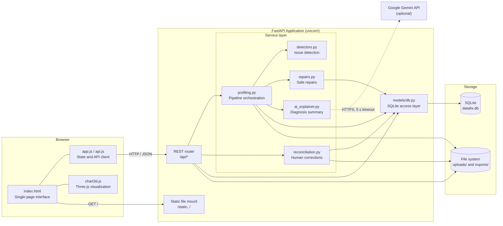
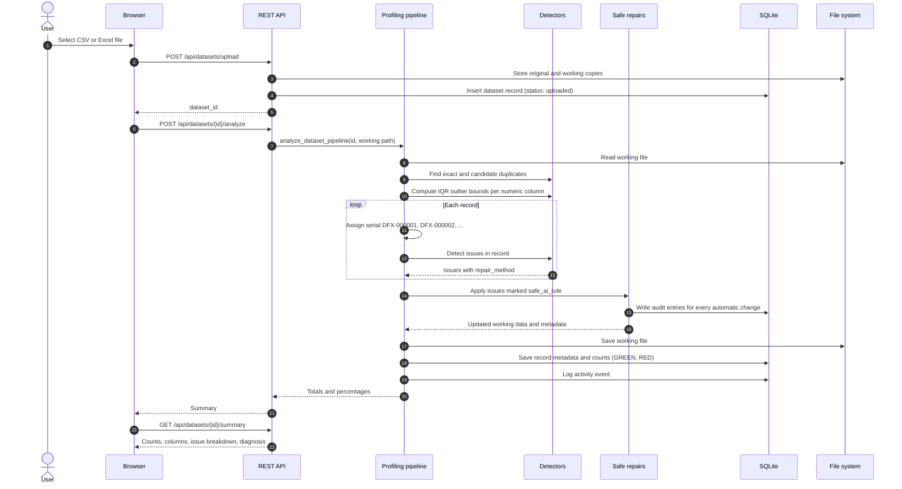
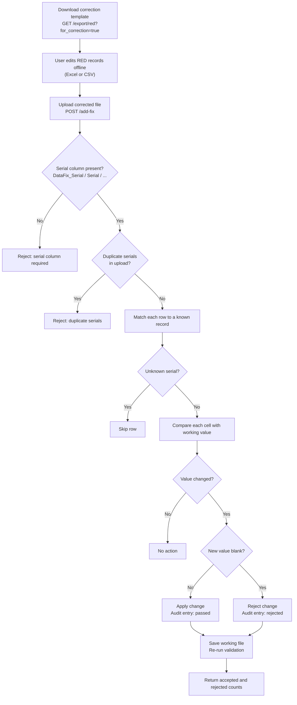
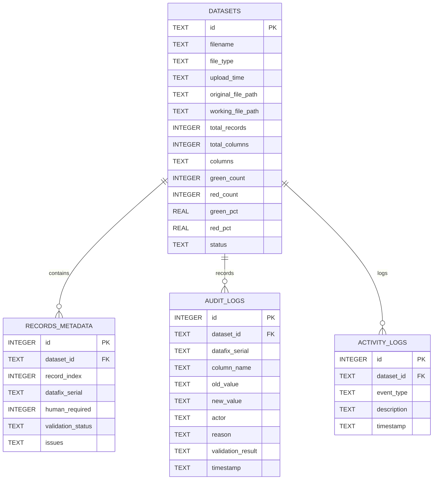

# RECODA: Autonomous Data Quality and Repair Engine

RECODA is a web application for inspecting tabular datasets (CSV, XLS, XLSX), detecting data-quality problems, applying a small set of provably safe repairs automatically, and routing every other issue to a human reviewer. Each record is classified as either GREEN (usable) or RED (requires human action). Every change is recorded in an audit trail, and changes can be rolled back.

The core design principle is that the system never invents facts. If a salary, identifier, or date of birth is missing, RECODA flags the record for a person to complete rather than guessing a value.

---

## Table of Contents

1. [Features](#features)
2. [Architecture](#architecture)
3. [Processing Pipeline](#processing-pipeline)
4. [Classification Model](#classification-model)
5. [Detection Rules](#detection-rules)
6. [Safe Repair Rules](#safe-repair-rules)
7. [Human Reconciliation](#human-reconciliation)
8. [Data Model](#data-model)
9. [API Reference](#api-reference)
10. [Project Structure](#project-structure)
11. [Installation and Local Setup](#installation-and-local-setup)
12. [Configuration](#configuration)
13. [Deployment](#deployment)
14. [Testing](#testing)
15. [Limitations](#limitations)

---

## Features

- **Dataset ingestion** for `.csv`, `.xlsx`, and `.xls` files. Legacy `.xls` files are converted to `.xlsx` on upload.
- **Quality profiling** across eight issue categories: missing values, whitespace, date formats, suspicious numeric values, statistical anomalies, duplicate records, invalid formats, and outliers.
- **Binary classification** of every record as GREEN or RED, with the exact column and reason for each issue.
- **Safe automatic repair** for whitespace normalization and unambiguous date standardization. Every automatic change is logged.
- **Human-in-the-loop reconciliation.** Users download a correction template keyed by stable serial numbers, edit it offline, and upload it back. Each change is validated before it is applied.
- **Audit trail and rollback.** All changes, human and automated, are recorded and can be reverted individually.
- **Clean export.** Output files contain only the original columns. No internal metadata is added.
- **Optional AI summary.** A Google Gemini model can generate a plain-language diagnosis. If no key is configured, or the request fails, a deterministic rule-based summary is returned instead.
- **Interactive 3D visualization** of dataset health, rendered with Three.js.

---

## Architecture

RECODA is a single-service application. A FastAPI backend exposes a REST API and also serves the static frontend. The backend stores data in SQLite and uses the local file system for uploaded and exported files.



### Component responsibilities

| Component | Responsibility |
|---|---|
| `frontend/index.html`, `css/` | Single-page interface: upload, dashboard, record explorer, reconciliation, audit view. |
| `frontend/js/api.js` | Thin client that wraps each REST endpoint. |
| `frontend/js/app.js` | Application state, rendering, and user interaction. |
| `frontend/js/chart3d.js` | Three.js scene for the 3D health visualization. |
| `backend/app/main.py` | Application factory. Initializes the database, registers the API router, enables CORS, and serves the frontend. |
| `backend/app/api/endpoints.py` | REST endpoints for upload, analysis, summaries, record views, exports, corrections, audit, and rollback. |
| `backend/app/services/profiling.py` | Orchestrates the analysis pipeline: loads the dataset, runs detection, applies repairs, computes totals. |
| `backend/app/services/detectors.py` | Row-level and column-level issue detection. |
| `backend/app/services/repairs.py` | Applies the safe, deterministic repairs and records each change. |
| `backend/app/services/reconciliation.py` | Validates and merges human-supplied corrections. |
| `backend/app/services/ai_explainer.py` | Produces the diagnosis summary, using Gemini when available. |
| `backend/app/models/db.py` | Schema creation and all SQLite read and write operations. |
| `backend/app/utils/helpers.py` | API key resolution, serial number generation, and JSON-safe serialization. |

---

## Processing Pipeline

Analysis is a two-step process. The user first uploads a file, which creates a dataset record and stores two copies on disk: an immutable `original` and a `working` copy that the engine modifies. The user then triggers analysis, which runs the full pipeline below.



### Stage details

1. **Load.** The working file is read with every column typed as `object`. This preserves raw values such as leading zeros and mixed formats, so the engine does not coerce data before inspecting it.
2. **Assign identity.** Each record receives a stable serial number from its position, in the form `DFX-000001`. Serial numbers are used by the correction template and the audit trail.
3. **Detect.** Each record is checked against every detector. Results are stored as a list of issues, each with a `repair_method` that is either `safe_ai_rule` or `human`.
4. **Repair.** Only issues marked `safe_ai_rule` are eligible. The repairer applies the change, writes an audit entry, and removes the issue from the record.
5. **Classify.** A record is RED if any issue with `repair_method = human` remains. Otherwise it is GREEN. Validation status is stored per record.
6. **Summarize.** Counts and percentages are stored on the dataset, and an activity event is logged. The diagnosis summary is then generated.

---

## Classification Model

Every record is in exactly one of two states:

| State | Stored value | Meaning |
|---|---|---|
| GREEN | `human_required = false` | The record has no unresolved issues, or all of its issues were repaired automatically. |
| RED | `human_required = true` | At least one issue requires a human decision. The record stays unchanged until a correction is supplied. |

A record stays RED until every human-required issue is resolved. Automatic repairs never move a record from RED to GREEN on their own if a human-required issue remains.

---

## Detection Rules

Detection runs per record. The detector never modifies data; it only reports issues.

| Issue type | Trigger | Repair method |
|---|---|---|
| `duplicate` | The record is an exact duplicate of another record, or the duplicate group matches on all columns. | `human` |
| `missing_value` | A cell is empty or null. Columns whose names match the critical-field list (for example `salary`, `id`, `name`, `email`, `phone`, `dob`) are flagged with a stronger message. | `human` |
| `whitespace` | A text value has leading, trailing, or repeated internal whitespace. | `safe_ai_rule` |
| `date_format` | A date can be parsed into one unambiguous ISO `YYYY-MM-DD` value. | `safe_ai_rule` |
| `date_format` | A date is invalid, out of range (before 1900 or after 2100), or ambiguous across formats (for example `01/02/2024`). | `human` |
| `suspicious_numeric` | An `age` value is below 0 or above 120. | `human` |
| `suspicious_numeric` | A negative value appears in a column that must be non-negative. Keywords include `salary`, `quantity`, `price`, `amount`, `cost`, `hours`, `experience`, and `inventory`. | `human` |
| `anomaly` | A numeric value falls outside the IQR bounds for its column. The bounds are the 25th and 75th percentiles extended by 3 times the interquartile range. Applied only to columns with at least 10 non-missing values. | `human` |
| `invalid_format` | A value in an email column does not match a basic `local@domain.tld` pattern. | `human` |

The outlier bounds use a generous multiplier of 3.0 on purpose. The goal is to surface genuinely unusual values, not ordinary variation.

---

## Safe Repair Rules

Only two repair types are permitted automatically. Both are deterministic and do not depend on any model's judgment.

**Whitespace normalization.** Leading and trailing whitespace is removed, and runs of internal whitespace are collapsed to a single space. Example: `"  Ana   Rao "` becomes `"Ana Rao"`.

**Unambiguous date standardization.** A date is converted to `YYYY-MM-DD` only if exactly one of the supported formats produces a valid interpretation. The supported formats are `YYYY-MM-DD`, `YYYY/MM/DD`, `YYYY.MM.DD`, `DD-MM-YYYY`, `DD/MM/YYYY`, `DD.MM.YYYY`, `MM/DD/YYYY`, `MM-DD-YYYY`, and the two datetime variants. If more than one format yields a different valid date, the value is treated as ambiguous and sent to a human. Example: `15/03/2024` is converted to `2024-03-15`, but `01/02/2024` is flagged because it could mean either January 2 or February 1.

Every automatic change writes an audit entry with the original value, the new value, the rule applied, and the actor `AI`.

The engine never automatically fills missing values, changes numeric values, merges or deletes duplicates, or alters identifiers.

---

## Human Reconciliation

Human corrections are handled through a template workflow, so that edits can be made in any spreadsheet tool and then verified before they are accepted.



### Validation rules

- The upload must contain a serial column named one of `DataFix_Serial`, `datafix_serial`, `DFX_Serial`, `DataFix Serial Number`, or `Serial`.
- Serial numbers must be unique within the upload.
- Rows with unknown serial numbers are ignored.
- Only cells whose value has changed are considered. Unchanged cells are never rewritten.
- A correction cannot replace a value with a blank. Blank corrections are rejected and logged.
- Every accepted and rejected change is written to the audit trail with the actor `Human`.
- After reconciliation, the record's human-required status is recalculated. A record becomes GREEN only when all of its issues are resolved.

### Rollback

Any entry in the audit trail can be rolled back with `POST /api/datasets/{id}/rollback`. The system restores the previous value in the working file, records the rollback as a new audit entry, and recalculates the record's status.

---

## Data Model

RECODA uses four SQLite tables. The database is created automatically on first startup.



Issues for each record are stored as a JSON list in `records_metadata.issues`. Each issue includes its column, issue type, description, repair method, and suggested action.

---

## API Reference

All endpoints are under the `/api` prefix. The interactive OpenAPI documentation is available at `/docs` when the server is running.

| Method | Endpoint | Purpose |
|---|---|---|
| `GET` | `/api/health` | Service status and whether a Gemini key is configured. |
| `POST` | `/api/datasets/upload` | Upload a CSV or Excel file. Creates the dataset and its working copy. |
| `POST` | `/api/datasets/{id}/analyze` | Run the full analysis pipeline. |
| `GET` | `/api/datasets/{id}/summary` | Counts, columns, issue breakdown, recent activity, and diagnosis text. |
| `GET` | `/api/datasets/{id}/records/green` | Records that are valid or fully repaired. |
| `GET` | `/api/datasets/{id}/records/red` | Records that require human action, with their issues. |
| `GET` | `/api/datasets/{id}/export/fixed` | Export GREEN records only, with original columns. Returns an error if no GREEN records exist. |
| `GET` | `/api/datasets/{id}/export/green` | Same as `export/fixed`. |
| `GET` | `/api/datasets/{id}/export/red` | Export RED records. `for_correction=true` (default) includes the `DataFix_Serial` column for reconciliation. `for_correction=false` returns original columns only. |
| `POST` | `/api/datasets/{id}/add-fix` | Upload a corrected file and reconcile it against the working dataset. |
| `GET` | `/api/datasets/{id}/audit` | Full audit trail, most recent first. |
| `POST` | `/api/datasets/{id}/rollback` | Revert a single audit entry. Body: `audit_id`. |

Upload accepts `multipart/form-data` with a `file` field. Analysis, summary, and export endpoints return JSON or file downloads as indicated above.

---

## Project Structure

```
RECODA/
├── backend/
│   ├── app/
│   │   ├── api/
│   │   │   └── endpoints.py          REST routes
│   │   ├── models/
│   │   │   └── db.py                 SQLite schema and data access
│   │   ├── schemas/
│   │   │   └── dataset.py            Pydantic models
│   │   ├── services/
│   │   │   ├── ai_explainer.py       Diagnosis summary (Gemini or fallback)
│   │   │   ├── detectors.py          Issue detection rules
│   │   │   ├── profiling.py          Analysis pipeline
│   │   │   ├── reconciliation.py     Human correction validation
│   │   │   └── repairs.py            Safe automatic repairs
│   │   ├── utils/
│   │   │   └── helpers.py            Key lookup, serials, JSON helpers
│   │   └── main.py                   Application entry point
│   ├── samples/                      Sample datasets for testing
│   ├── tests/                        Unit and integration tests
│   ├── generate_samples.py           Generates sample datasets
│   └── requirements.txt
├── frontend/
│   ├── css/styles.css
│   ├── js/
│   │   ├── api.js                    REST client
│   │   ├── app.js                    Application logic
│   │   └── chart3d.js                3D visualization
│   ├── samples/
│   └── index.html
├── Docs/                             Reference documents and sample outputs
├── api_key.example.txt               Template for the optional Gemini key
├── .gitignore
└── README.md
```

Runtime directories `backend/database/`, `backend/uploads/`, and `backend/exports/` are created automatically and are excluded from version control.

---

## Installation and Local Setup

### Requirements

- Python 3.10 or later (3.12 recommended)
- A modern web browser (Chrome, Edge, or Firefox)

### Steps

1. Clone the repository and enter the project directory.

   ```bash
   git clone https://github.com/YOUR_USERNAME/recoda.git
   cd recoda
   ```

2. Install the dependencies.

   ```bash
   pip install -r backend/requirements.txt
   ```

3. Start the server from the `backend` directory.

   ```bash
   cd backend
   python -m uvicorn app.main:app --host 127.0.0.1 --port 8000 --reload
   ```

4. Open `http://127.0.0.1:8000` in a browser.

The database and storage directories are created on first run. No further setup is needed for profiling, detection, repair, or reconciliation. Only the AI summary requires configuration.

---

## Configuration

The Gemini API key is optional. It is resolved in this order:

1. `api_key.txt` in the project root (copy `api_key.example.txt` and paste the key).
2. `api_key.txt` in the `backend` directory.
3. The environment variable `GEMINI_API_KEY`, then `GOOGLE_API_KEY`, then `OPENAI_API_KEY`.

For production, use an environment variable rather than a file. Never commit `api_key.txt` to version control. The `.gitignore` file already excludes it.

If no key is found, or the Gemini request fails or times out after 5 seconds, RECODA returns a deterministic rule-based summary. The application never fails because of the AI service.

---

## Deployment

RECODA runs as a standard long-lived Python web service. The following settings apply to a Render Web Service, but any platform that runs a Python process will work.

| Setting | Value |
|---|---|
| Runtime | Python 3 |
| Root directory | (repository root) |
| Build command | `pip install -r backend/requirements.txt` |
| Start command | `cd backend && uvicorn app.main:app --host 0.0.0.0 --port $PORT` |
| Health check path | `/api/health` |
| Environment variables | `GEMINI_API_KEY` (optional), `PYTHON_VERSION` = `3.12.8` |

**Storage.** Datasets and the SQLite database are written to the local disk. On platforms with ephemeral file systems, this data is lost on every restart or redeploy. For durable storage, attach a persistent disk to the service and mount it at `backend/database`, or move storage to an external database.

**Cold starts.** Free-tier hosting may sleep after a period of inactivity. The first request after a sleep can take up to a minute.

---

## Testing

Run the automated test suite from the `backend` directory.

```bash
cd backend
python -m unittest discover tests -v
```

The suite includes an end-to-end endpoint test that covers the full lifecycle (upload, analysis, export, correction, audit, and rollback) and a pipeline test that verifies analysis output. The `samples/` directory contains datasets that can be used for manual testing.

---

## Limitations

- **Single-node storage.** SQLite and local file storage support one running instance. Horizontal scaling requires a shared database and object storage.
- **No authentication.** The API is open to anyone who can reach the server. Add authentication before exposing the service publicly with real data.
- **Format coverage.** Date detection supports the formats listed above. Other locale-specific formats are flagged for human review rather than converted.
- **Duplicate detection** matches exact duplicate rows only. Fuzzy matching is not performed.
- **Size.** The engine loads the full dataset into memory. Very large files will need chunked processing.
- **AI summary** is a convenience only. It does not influence any classification or repair decision.

---

## License

This project was developed for a hackathon organized by the INNOVEDGE Innovation and Entrepreneurship Development Club. Add the license that applies to your project before publishing.
